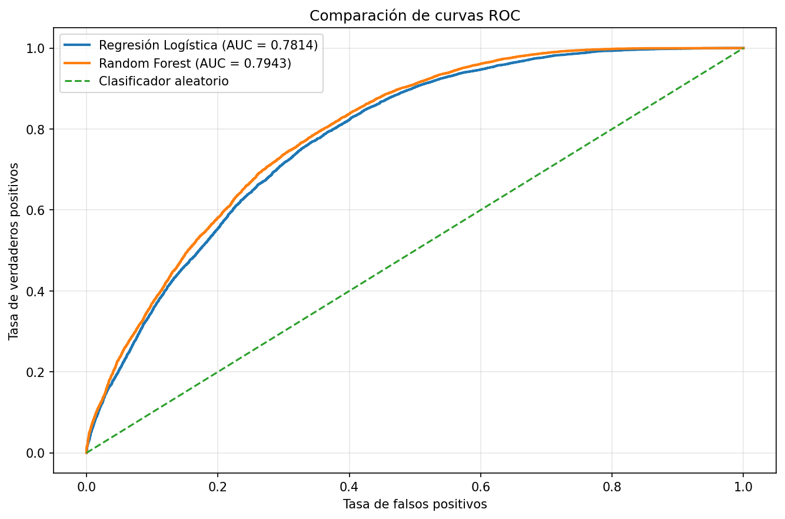
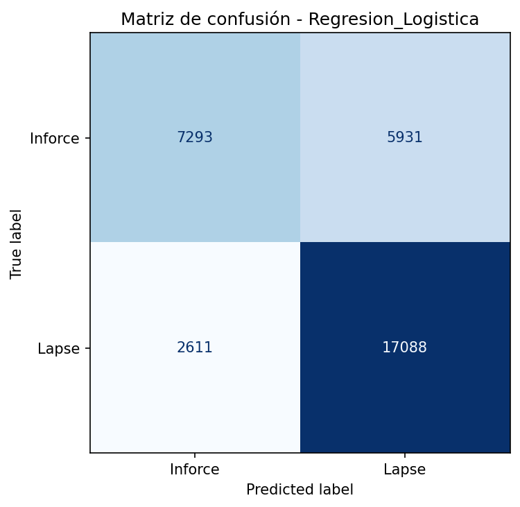
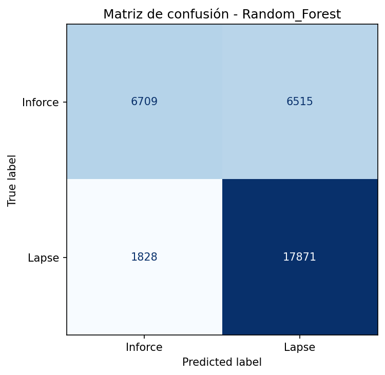

# Actividad 5 - Clasificación de pólizas de seguros de vida

## 1. Descripción del proyecto

Proyecto de Machine Learning desarrollado como parte del Máster en Inteligencia Artificial.

El objetivo es construir, optimizar y comparar dos algoritmos de clasificación supervisada para identificar pólizas de seguros de vida vigentes y canceladas.

Los algoritmos utilizados son:

- Regresión Logística.
- Random Forest.

Se utiliza MLflow para registrar experimentos, parámetros, métricas y modelos.

## 2. Dataset

**Fuente:** Kaggle - Life Insurance Policy Data.

https://www.kaggle.com/datasets/blackclover1/life-insurance-policy-data

El dataset original contiene 185,560 registros.

Después de aplicar las reglas de preparación se obtienen 164,679 registros y 22 columnas.

La variable objetivo es `TARGET`:

- `1`: Lapse (póliza cancelada).
- `0`: Inforce (póliza vigente).

Distribución de clases:

| Clase | Registros |
|---|---:|
| Lapse | 98,865 |
| Inforce | 65,814 |

Se seleccionan 16 variables predictoras.

## 3. Preparación de datos

La preparación se implementa en `fuentes/datos_prep.py`.

Incluye revisión de duplicados, valores faltantes, variables monetarias, categorías, fechas y consistencia de registros.

Los valores faltantes se tratan dentro de los pipelines de preprocesamiento, según el tipo de variable.

## 4. División de datos

Se utiliza GroupShuffleSplit con:

- Entrenamiento: 80 %.
- Prueba: 20 %.
- Random state: 42.

Resultados:

| Conjunto | Registros |
|---|---:|
| Entrenamiento | 131,756 |
| Prueba | 32,923 |

La separación por grupos evita compartir perfiles idénticos entre entrenamiento y prueba.

## 5. Modelos

### Regresión Logística

Configuración principal:

- C = 0.1
- max_iter = 1000
- random_state = 42

### Random Forest

Configuración principal:

- n_estimators = 30
- max_depth = 16
- min_samples_leaf = 3
- random_state = 42

## 6. Validación cruzada y optimización

Se utiliza StratifiedGroupKFold con cinco particiones.

La optimización de hiperparámetros se realiza mediante RandomizedSearchCV, utilizando F1-score como métrica principal.

F1 promedio en validación cruzada de las configuraciones finales:

| Modelo | F1 CV |
|---|---:|
| Regresión Logística | 0.7980 |
| Random Forest | 0.8084 |

## 7. Evaluación final

Resultados sobre el conjunto de prueba:

| Métrica | Regresión Logística | Random Forest |
|---|---:|---:|
| Accuracy | 0.7405 | 0.7466 |
| Precision | 0.7423 | 0.7328 |
| Recall | 0.8675 | 0.9072 |
| F1-score | 0.8000 | 0.8108 |
| ROC-AUC | 0.7814 | 0.7943 |

Random Forest obtiene el mayor F1-score, recall y ROC-AUC.

Regresión Logística presenta una precisión ligeramente superior.

También se realiza una comparación estadística mediante la prueba de McNemar.

### Evidencias gráficas







## 8. Seguimiento con MLflow

MLflow permite registrar:

- Hiperparámetros.
- Métricas de entrenamiento y evaluación.
- Resultados de validación cruzada.
- Artefactos y gráficas.
- Pipelines completos.

Los modelos se serializan mediante skops y se verifica la coincidencia de predicciones después de recuperarlos.

La base SQLite y los artefactos locales de MLflow no se publican en GitHub.

## 9. Estructura del repositorio

```text
Actividad5JCP/
├── datos/
│   ├── datos_ini/
│   └── datos_limp/
├── fuentes/
│   ├── datos_prep.py
│   ├── train.py
│   └── entrena.ipynb
├── resultados/
├── graficos/
├── requirements.txt
├── README.md
├── CHANGELOG.md
└── .gitignore
```

## 10. Instalación y ejecución

Clonar el repositorio:

```bash
git clone https://github.com/al07182911/Actividad5JCP.git
cd Actividad5JCP
```

Instalar dependencias:

```bash
pip install -r requirements.txt
```

Obtener el dataset desde Kaggle y colocarlo en:

`datos/datos_ini/Kaggle.csv`

Ejecutar el entrenamiento:

```bash
python fuentes/train.py
```

También se puede consultar el notebook `fuentes/entrena.ipynb` en Google Colab.

## 11. Reproducibilidad

Se realizaron pruebas independientes utilizando una copia del
repositorio descargada desde GitHub, correspondiente al commit
`0b11e0a`.

### Preparación y división de datos

- Descarga independiente del dataset desde Kaggle.
- Preparación de 164,679 registros y 22 columnas.
- Selección de 16 variables predictoras.
- División en 131,756 registros de entrenamiento y
  32,923 registros de prueba.
- Verificación de cero perfiles compartidos entre conjuntos.

### Validación cruzada

Se reprodujo la validación cruzada con cinco particiones
mediante StratifiedGroupKFold.

| Modelo | F1 CV reproducido |
|---|---:|
| Regresión Logística inicial | 0.7978 |
| Random Forest rápido | 0.8056 |

### Optimización de hiperparámetros

Se reprodujeron las búsquedas originales mediante
RandomizedSearchCV.

| Modelo | Mejor F1 CV |
|---|---:|
| Regresión Logística | 0.7980 |
| Random Forest | 0.8084 |

Las puntuaciones de las combinaciones evaluadas coincidieron
con los resultados históricos consultados.

### Evaluación final

Las métricas obtenidas sobre los 32,923 registros de prueba
coincidieron con los resultados históricos a seis decimales.

| Métrica | Regresión Logística | Random Forest |
|---|---:|---:|
| Accuracy | 0.740546 | 0.746591 |
| Precision | 0.742343 | 0.732839 |
| Recall | 0.867455 | 0.907203 |
| F1-score | 0.800037 | 0.810752 |
| ROC-AUC | 0.781445 | 0.794283 |

### Comparación estadística

Se reprodujo la tabla de contingencia de McNemar,
obteniendo una coincidencia exacta con la tabla histórica.

- Estadístico: 19.710407.
- Valor p: 9.010929716394214e-06.
- Nivel de significancia: 0.05.

### Registro y recuperación de modelos

Los pipelines optimizados se registraron en MLflow utilizando
serialización skops.

Ambos modelos se recuperaron correctamente y produjeron
predicciones idénticas a las originales sobre una muestra
de 100 registros.

### Portabilidad del notebook

Se corrigieron las celdas 3 y 25 para mejorar la detección
del directorio del proyecto y la exportación de datos.

La detección del repositorio se validó desde su directorio
raíz y desde la carpeta `fuentes/`.

Para utilizar esta configuración, el notebook debe ejecutarse
desde uno de esos directorios.

### Limitación pendiente

Las etapas principales del proyecto fueron verificadas
por separado en el entorno independiente.

La ejecución consecutiva completa de las 64 celdas del
notebook desde una única sesión limpia continúa pendiente
de verificación.

El script `train.py` utiliza las configuraciones finales
seleccionadas durante la optimización.

## 12. Conclusiones

Random Forest presenta el mejor rendimiento general según F1-score y ROC-AUC, además de identificar una mayor proporción de pólizas canceladas.

Regresión Logística constituye una alternativa más sencilla y con precisión ligeramente superior.

Los resultados corresponden al dataset analizado y requieren validación adicional antes de utilizarse en decisiones operativas reales.
